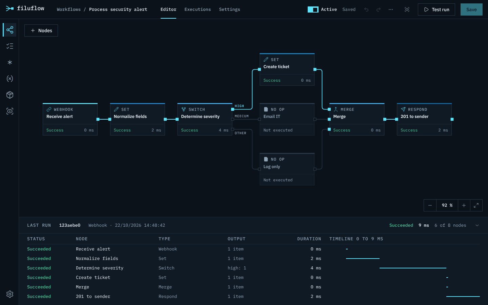
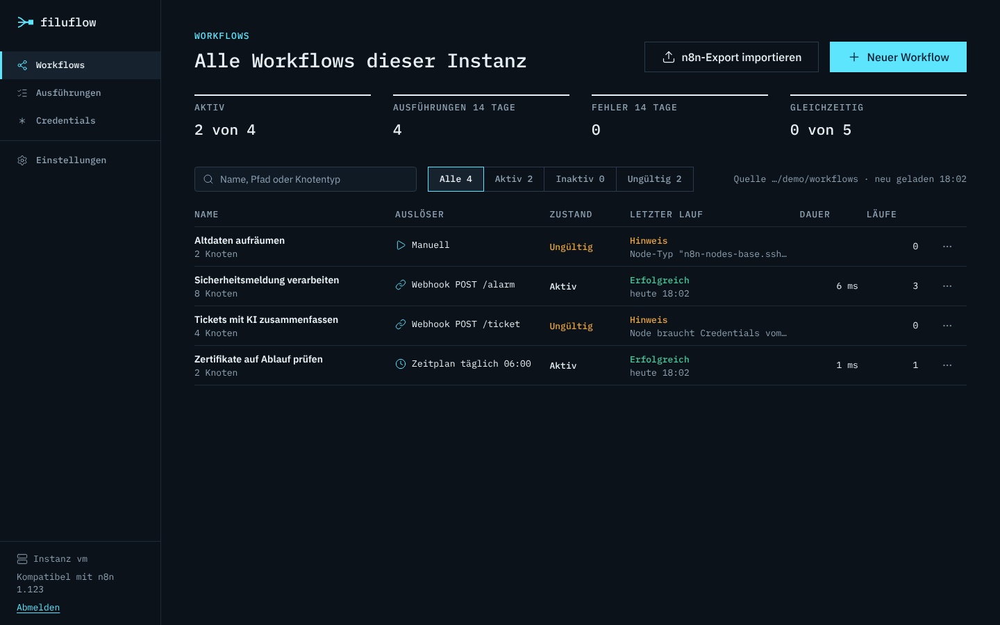
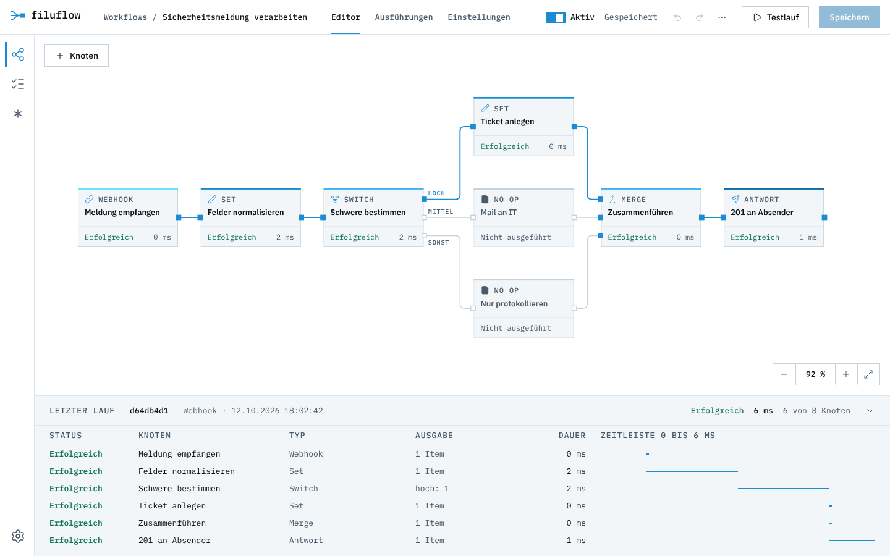

<p align="center">
  <picture>
    <source media="(prefers-color-scheme: dark)" srcset="docs/assets/filuflow-logo-dark.svg">
    
  </picture>
</p>

<p align="center">
  <strong>Workflows bauen, ausführen und nachvollziehen. Auf eigenen Servern, für ein Team oder viele Mandanten.</strong>
</p>

<p align="center">
  <a href="#schnellstart">Schnellstart</a> ·
  <a href="#weboberfläche">Weboberfläche</a> ·
  <a href="#server-und-api">Server und API</a> ·
  <a href="#mehrere-benutzer-und-mandanten">Master und Worker</a> ·
  <a href="#konfiguration">Konfiguration</a> ·
  <a href="#dokumentation">Dokumentation</a>
</p>



filuflow (lat. *filum*, der Faden) ist eine schlanke Workflow-Engine mit Editor im Browser. Ein Workflow verbindet Knoten
zu einem Ablauf: ein Webhook nimmt eine Meldung an, Knoten formen die Daten um, verzweigen, rufen Dienste und KI-Modelle auf
und antworten. Jeder Lauf wird protokolliert und lässt sich Knoten für Knoten nachvollziehen.

## Was filuflow kann

| | |
|---|---|
| **Editor im Browser** | Knoten einfügen und verbinden, Parameter als Formular oder JSON, Rückgängig und Wiederholen, Testlauf mit dem aktuellen Stand |
| **Nachvollziehbare Läufe** | Status und Dauer an jedem Knoten, der durchlaufene Pfad hervorgehoben, "Letzter Lauf" mit Zeitleiste, Ausführungsprotokoll in SQLite |
| **Auslöser** | Webhooks mit Antwort-Knoten und Authentifizierung, Zeitpläne, Fehler-Workflows, Aufruf durch andere Workflows, REST-API |
| **Knoten** | Daten setzen, filtern, sortieren, zusammenfassen, verzweigen (If, Switch), zusammenführen, Schleifen, Code (JavaScript und Python), HTTP (mit Pagination, Digest-Auth, Client-Zertifikaten), HTML, XML, Datum, Krypto |
| **KI** | AI Agent mit Tools, LLM Chain, Extraktion, Klassifikation, Stimmungsanalyse; Modelle von OpenAI, Anthropic, Google Gemini, Azure, Mistral, Groq, DeepSeek, OpenRouter und Ollama; Embeddings, Vektorspeicher und Q&A Chain (RAG) |
| **Aufseher** | ein Modell behält die Workflows im Blick: feste Regeln, Analyse fehlgeschlagener Läufe, Tagesbericht, Verbesserungen als geprüfter Vorschlag mit Diff, Gespräch im Editor, auch im Master je Worker; ein Mensch entscheidet |
| **Credentials** | in der Oberfläche anlegen und bearbeiten (Formulare je Typ) oder als Datei pflegen, verschlüsselt mit AES-256-GCM, Werte aus Umgebungsvariablen; geheime Werte erscheinen nie in Logs oder der Oberfläche |
| **Team und Mandanten** | Master mit Benutzern, Rechten und Projekten; Worker in der Umgebung jedes Mandanten; Anmeldung mit Passwort und TOTP oder SSO (OIDC) |
| **Kommandozeile** | Workflows prüfen und ausführen, Ausführungen ansehen, Credentials verschlüsseln, Benutzer verwalten |
| **Kompatibel mit n8n** | Exportierte n8n-Workflows laufen ohne Umbau, kopierte n8n-Knoten lassen sich in den Editor einfügen |
| **Eigene Knoten** | Plugins als JavaScript-Modul oder Knoten im n8n-Format (eigene Ordner und Community-Pakete mit `execute`) |

## Schnellstart

Voraussetzung: Node.js 22.

```bash
npm install
npm run build
FILUFLOW_API_KEY=geheim npx filuflow serve --dir ./workflows
```

Dann `http://localhost:5678/` öffnen und mit dem API-Key `geheim` anmelden. Workflows liegen als JSON-Dateien in `./workflows`;
neue Workflows lassen sich im Editor anlegen oder als Datei ablegen (der Server lädt Änderungen automatisch).

Mit Docker:

```bash
FILUFLOW_API_KEY=geheim docker compose up -d --build
```

## Weboberfläche

<p>
  
  
</p>

- **Workflows:** Kennzahlen (aktive Workflows, Ausführungen und Fehler der letzten 14 Tage, Auslastung), Suche und Filter
  (Alle, Aktiv, Inaktiv, Ungültig) und eine Tabelle mit Auslöser, Zustand, letztem Lauf, Dauer und Läufen.
- **Editor:** Knoten über **Knoten** oben links (oder Taste N) einfügen; ein Klick hängt den neuen Knoten an den ausgewählten an.
  Ausgang auf Eingang ziehen verbindet, eine Verbindung anklicken und Entf löscht sie. Rechts stehen Parameter, Credentials,
  Einstellungen (deaktiviert, Fehlerverhalten, Wiederholen, Notizen) und nach dem Lauf das Ergebnis als Tabelle oder JSON.
  Parameter bearbeiten Sie im **Formular** mit Feldern je Knotentyp (Auswahllisten, Bedingungen, Zuweisungen, Optionen);
  **Baum** und **JSON** zeigen dieselben Parameter ungefiltert.
- **Speichern** schreibt die Datei ins Workflow-Verzeichnis, der Schalter **Aktiv** schaltet Webhooks und Zeitpläne an.
  **Testlauf** führt den aktuellen, auch ungespeicherten Stand aus. **Bis hier ausführen** (Knopf oben im Panel) führt nur
  den gewählten Knoten und die Knoten davor aus. Bei Webhook- und Formular-Triggern wartet **Auf Test-Aufruf warten** auf
  den nächsten Aufruf der Test-URL und führt dabei den Stand im Editor aus.
- **Testdaten:** Im Tab **Ergebnis** hält **Festhalten** die Ausgabe eines Knotens fest (`pinData`), **Testdaten eingeben**
  setzt eigene Daten. Beim Testlauf liefert der Knoten dann diese Daten, statt zu laufen; am Knoten erscheint eine Nadel.
- **Variablen:** Werte für `$vars` pflegen Sie unter **Variablen**; sie wirken sofort in allen Workflows. Einträge aus
  `vars.json` bleiben in der Datei und haben Vorrang.
- **Letzter Lauf** unter dem Canvas: Status, Typ, Ausgabe und Dauer je Knoten mit Zeitleiste; ein Klick wählt den Knoten.
- **Ausführungen:** Liste mit Filter nach Workflow und Status, Detailansicht mit dem Workflow-Stand der Ausführung.
- Farbschema dunkel (Standard) oder hell unter **Einstellungen**.

<details>
<summary>Tastenkürzel im Editor</summary>

| Taste | Wirkung |
|---|---|
| Strg+S | Speichern |
| Strg+Enter | Testlauf |
| N | Knoten hinzufügen |
| Strg+Z, Strg+Umschalt+Z | Rückgängig, Wiederholen |
| Strg+C, Strg+X, Strg+V | Kopieren, Ausschneiden, Einfügen (auch Knoten aus n8n) |
| Strg+A | Alles auswählen |
| Entf | Auswahl löschen |
| D | Knoten deaktivieren oder aktivieren |
| 1 | Einpassen |
| Esc | Auswahl aufheben |
| Umschalt+Ziehen | Rahmenauswahl |
| Strg+Mausrad | Zoomen |

</details>

## Server und API

```bash
FILUFLOW_API_KEY=geheim filuflow serve --dir ./workflows --port 5678 --db ./filuflow.db
```

- Lädt alle `*.json` aus `--dir` und lädt bei Änderungen neu. Aktive Workflows registrieren Webhooks (`/webhook/<pfad>`) und
  Zeitpläne; Test-URLs (`/webhook-test/<pfad>`) gibt es für alle gültigen Workflows.
- Ungültige Workflows (zum Beispiel mit unbekannten Knoten) werden nicht aktiviert. Der Grund steht im Log, in der Übersicht und
  in `GET /api/workflows`.
- Ausführungen landen in SQLite, standardmäßig 14 Tage lang; höchstens 5 laufen gleichzeitig, weitere warten.
- **Formulare:** Der Form Trigger stellt ein Formular unter `/form/<pfad>` bereit (Test: `/form-test/<pfad>`), mit Feldern
  für Text, Zahl, E-Mail, Datum, Auswahl, Checkboxen, Radio-Buttons, Dateien, versteckte Felder und eigenes HTML. Mit dem
  Form-Knoten folgen weitere Seiten und eine Abschlussseite; der Wait-Knoten kann ebenfalls auf ein Formular warten. Die Seiten
  sind normale HTML-Formulare ohne Skript.
- **Warten:** Der Wait-Knoten hält eine Ausführung an, bis eine Zeit erreicht ist oder ein Webhook kommt
  (`$execution.resumeUrl`, also `/webhook-waiting/<ausführung>`, optional mit Suffix und Authentifizierung). Wartende
  Ausführungen liegen in der Datenbank und überstehen einen Neustart; in der Liste steht, worauf sie warten, und sie lassen
  sich abbrechen. Statische Daten (`$getWorkflowStaticData`) und OAuth2-Tokens bleiben ebenfalls über Neustarts erhalten.

<details>
<summary>REST-API (Header <code>X-API-Key</code>)</summary>

| Methode und Pfad | Zweck |
|---|---|
| `GET /api/workflows` | alle Workflows mit Zustand, Auslösern und Gültigkeit |
| `GET /api/workflows/:id` | ein Workflow mit Prüfergebnis |
| `POST /api/workflows/:id/run` | ausführen; Body = Start-Items, `?wait=false` für asynchron |
| `GET /api/executions?workflow=&status=&limit=` | Ausführungen |
| `GET /api/executions/:id` | eine Ausführung mit Daten je Knoten |
| `POST /api/executions/:id/cancel` | laufende oder wartende Ausführung abbrechen |
| `ANY /webhook-waiting/:id[/suffix]` | wartende Ausführung fortsetzen (Wait "On Webhook Call") |
| `GET /api/overview` | Kennzahlen der letzten 14 Tage, letzte Ausführung je Workflow |
| `GET /healthz` | Lebenszeichen (ohne API-Key) |

</details>

<details>
<summary>Beispiel mit curl</summary>

```bash
mkdir -p /tmp/fl/workflows && cp fixtures/08-webhook-respond/workflow.json /tmp/fl/workflows/
cd /tmp/fl && FILUFLOW_API_KEY=geheim filuflow serve --port 5690 --dir workflows &

curl -i -X POST 'http://localhost:5690/webhook/fl-fixture-08?n=3' -H 'content-type: application/json' -d '{"name":"Ada"}'
# HTTP/1.1 201 Created
# {"gruss":"Hallo Ada","anzahl":6,"tags":null}

curl -s -H 'X-API-Key: geheim' 'http://localhost:5690/api/executions?limit=5'
filuflow executions list --db /tmp/fl/filuflow.db
```

</details>

### Kommandozeile

```bash
filuflow validate <workflow.json> [--json]
filuflow run <workflow.json> [--input items.json] [--trigger "Knoten"] [--json] [--only-last] [--no-pin]
filuflow executions list|show <id> [--json] [--db ./filuflow.db]
filuflow credentials encrypt|decrypt|check <credentials.json>
filuflow credentials import <n8n-export.json> [--n8n-key <k>] [--out <datei> | --managed <datei>]
filuflow nodes [--json]
```

`filuflow run` prüft den Workflow vorab (unbekannte Knoten oder Versionen brechen ab, bevor etwas läuft) und zeigt danach eine
Übersicht je Knoten:

```text
$ filuflow run fixtures/01-linear/workflow.json
Workflow "01 Lineare Kette", Execution efdf1bcf-...
  OK     Start        0 ms  1 Item
  OK     Felder      22 ms  1 Item
  OK     Erzeugen     2 ms  5 Items
  OK     Gross?       4 ms  Ausgang 0: 4, Ausgang 1: 1
  OK     Wahr         0 ms  4 Items
  OK     Falsch       2 ms  1 Item
Status: success, Dauer 33 ms
```

<details>
<summary>Optionen von <code>run</code></summary>

- `--input`: Start-Items, als Array aus `{ "json": ... }` oder einfachen Objekten
- `--trigger`: Start-Knoten, wenn der Workflow mehrere Auslöser hat
- `--json`: vollständige Ausführung inklusive Daten je Knoten (Credential-Werte maskiert)
- `--only-last`: nur die Ausgabe des zuletzt ausgeführten Knotens
- `--no-pin`: fest hinterlegte Testdaten (`pinData`) ignorieren
- `--credentials`, `--vars`, `--workflows`: Credentials, Variablen (`$vars`) und Verzeichnis für Unter-Workflows

Exit-Code 0 bei Erfolg, 1 bei Fehlern (Prüfung oder fehlgeschlagene Ausführung).

</details>

## Credentials

Am einfachsten legen Sie Credentials in der Oberfläche an: Seite **Credentials** oder direkt im Editor über die Auswahl am Knoten
("Neues Credential anlegen"). Das Formular kennt die Felder der eingebauten Typen und blendet je nach Auswahl die passenden ein;
für andere Typen geben Sie die Felder frei an. Geheime Felder (Passwörter, Tokens, API-Keys) werden nach dem Speichern nie wieder
angezeigt: Ein leeres Feld beim Bearbeiten behält den gespeicherten Wert. Die Oberfläche zeigt außerdem, welche Workflows ein
Credential verwenden.

**OAuth2 mit Anmeldung beim Anbieter** (Grant Type "Authorization Code" oder "PKCE", z. B. Google, Microsoft 365, Slack):
tragen Sie beim Anbieter die Redirect-URL `<FILUFLOW_WEBHOOK_URL>rest/oauth2-credential/callback` ein (dieselbe wie bei
n8n, das Formular zeigt sie an), legen Sie das Credential an und klicken Sie in der Liste auf **Verbinden**. Das Token liegt
verschlüsselt in der Datenbank und wird bei abgelaufenem Zugriff mit dem Refresh-Token erneuert. Im Master läuft die
Anmeldung über die Adresse des Masters, das Token liegt beim Worker.

Für viele Dienste gibt es eigene OAuth2-Typen mit den Daten von n8n, etwa `googleOAuth2Api`, `gmailOAuth2`,
`googleSheetsOAuth2Api`, `googleDriveOAuth2Api`, `microsoftOAuth2Api`, `microsoftOutlookOAuth2Api`, `microsoftTeamsOAuth2Api`,
`slackOAuth2Api`, `githubOAuth2Api`, `notionOAuth2Api`, `hubspotOAuth2Api`, `airtableOAuth2Api`, `salesforceOAuth2Api` und
weitere (insgesamt 47). Dort tragen Sie nur Client ID und Client Secret ein (bei manchen Diensten zusätzlich Server, Subdomain
oder Umgebung); URLs, Scopes und Grant Type legt der Typ fest. Exportierte n8n-Workflows mit diesen Credentials laufen so
ohne Umbau.

**Vordefinierte Credential-Typen** im HTTP Request ("Vordefinierter Credential-Typ"): filuflow kennt die Anmeldung von
`githubApi`, `notionApi`, `slackApi`, `stripeApi`, `airtableTokenApi`, `hubspotAppToken`, `openAiApi`, `anthropicApi`,
`googlePalmApi` und den generischen Typen, dazu Typen aus Plugins. OAuth2-Typen (die eingebauten oben, Typen auf
`…OAuth2Api` aus einem n8n-Import oder aus Plugins) nutzen das verbundene Token, mit den Eigenheiten der Dienste wie bei
n8n (z. B. Slack mit dem Benutzer-Token). Dasselbe gilt für das HTTP Request Tool am AI Agent.

**OAuth1** (`oAuth1Api`, z. B. ältere APIs von Twitter/X, Trello oder Xero) funktioniert genauso: Consumer Key und Secret sowie
die drei URLs des Anbieters eintragen, speichern, **Verbinden**. Als Rückleitung nutzt filuflow
`<FILUFLOW_WEBHOOK_URL>rest/oauth1-credential/callback`.

**Aus n8n übernehmen**: Mit `n8n export:credentials --all --output=export.json` exportierte Credentials (verschlüsselt oder mit
`--decrypted`) übernimmt der Knopf **Aus n8n übernehmen** auf der Seite Credentials, im Master auf der Worker-Seite. Für
verschlüsselte Exporte geben Sie den n8n-Schlüssel an (`N8N_ENCRYPTION_KEY` der n8n-Instanz). Auf der Kommandozeile geht es mit
`filuflow credentials import export.json --n8n-key ... --managed credentials.managed.json`. IDs bleiben erhalten, sodass
importierte Workflows ihre Credentials finden.

**Teilen im Master**: Credentials eines Workers stehen zunächst allen Projekten dieses Workers zur Verfügung. Über das Symbol
**Freigabe** auf der Worker-Seite beschränken Sie ein Credential auf einzelne Projekte.

In der Oberfläche angelegte Credentials landen in `credentials.managed.json` (Dateirechte 0600, mit `FILUFLOW_ENCRYPTION_KEY`
verschlüsselt; Pfad über `FILUFLOW_MANAGED_CREDENTIALS`). Ohne Schlüssel weist die Oberfläche darauf hin.

Alternativ oder zusätzlich stehen Credentials in `credentials.json` (oder in einem Verzeichnis mit einer Datei je Credential).
Diese Einträge sind in der Oberfläche sichtbar, aber nur in der Datei änderbar, und haben Vorrang. Der Schlüssel ist der Name,
unter dem ein Workflow das Credential verwendet:

```json
{
  "API Header": { "id": "abc123", "type": "httpHeaderAuth", "data": { "name": "X-Api-Key", "value": "{{ env.API_KEY }}" } },
  "Token-Server": { "type": "oAuth2Api", "data": { "grantType": "clientCredentials", "accessTokenUrl": "https://auth.example/token",
                    "clientId": "filuflow", "clientSecret": "{{ env.OAUTH_SECRET }}", "scope": "lesen", "authentication": "header" } }
}
```

- Typen: `httpHeaderAuth`, `httpBasicAuth`, `httpDigestAuth`, `httpQueryAuth`, `httpBearerAuth`, `httpCustomAuth`, `oAuth2Api`,
  `oAuth1Api`, `jwtAuth`, `httpSslAuth` (Client-Zertifikat und eigene CA für "SSL Certificates"),
  für KI-Modelle `openAiApi`, `anthropicApi` und `googlePalmApi` (jeweils `apiKey`, optional eigene URL).
- `{{ env.NAME }}` holt Werte aus der Umgebung; `filuflow validate` meldet fehlende Credentials und Variablen.
- Verschlüsseln: `FILUFLOW_ENCRYPTION_KEY=... filuflow credentials encrypt credentials.json --out credentials.enc.json`.
  Namen und Typen bleiben lesbar, `decrypt` zum Bearbeiten, `check` zum Prüfen.
- Geheime Werte verlassen den Server nicht und erscheinen maskiert im Protokoll; die REST-API dazu steht unter `/api/credentials`.

## Code in JavaScript und Python

Der Code-Knoten kennt drei Sprachen (Auswahl **Sprache** im Editor):

- **JavaScript**: alle Variablen der Expressions (`$input`, `$json`, `$('Knoten')`, `$now` …), `console.log` landet im
  Protokoll der Ausführung. `helpers` bietet wie in n8n `httpRequest`, `httpRequestWithAuthentication` (mit einem
  Credential am Knoten), `returnJsonArray`, `constructExecutionMetaData`, `prepareBinaryData`, `getBinaryDataBuffer` u. a.
- **Python**: läuft mit [Pyodide](https://pyodide.org) (CPython als WebAssembly) direkt im Server, ohne installiertes Python.
  Die Variablen heißen wie in n8n mit `_` statt `$`: `_input.all()`, `_json`, `_('Knoten')`, `_now`, `_jmespath()`.
  Objekte lassen sich als Attribut oder Schlüssel lesen (`item.json.name`, `item.json['name']`), `print()` landet im Protokoll.
  Die Standardbibliothek ist dabei; Pakete wie numpy oder pandas lädt Pyodide beim ersten `import` aus dem Netz nach
  (`FILUFLOW_PYTHON_PACKAGES_DIR`). Der erste Lauf nach dem Start dauert etwa zwei Sekunden, nutzt ein Workflow Python,
  lädt der Server Pyodide schon beim Start.
- **Python (Native)**: nutzt den Python-Interpreter des Servers (`FILUFLOW_PYTHON`, Default `python3`) in einem eigenen
  Prozess je Ausführung, mit allen dort installierten Paketen. Wie im Task-Runner von n8n gibt es nur `_items` (alle Items) bzw.
  `_item` (je Item) als dicts. Imports sind nur mit Freigabe erlaubt: `FILUFLOW_PYTHON_STDLIB_ALLOW=json,datetime,re` und
  `FILUFLOW_PYTHON_EXTERNAL_ALLOW=numpy` (`*` für alle; die n8n-Namen `N8N_RUNNERS_STDLIB_ALLOW` usw. gelten auch).
  Builtins wie `eval`, `open` oder `getattr` sind gesperrt (`FILUFLOW_PYTHON_BUILTINS_DENY`), die Umgebung ist leer
  (`FILUFLOW_PYTHON_ENV_ACCESS=true` gibt sie frei).

```python
# Python: alle Items durchlaufen
for item in _input.all():
    item.json.summe = item.json.netto * 1.19
return _input.all()
```

Alle Varianten haben ein Zeitlimit (`FILUFLOW_CODE_TIMEOUT_MS`, Default 60 s), das auch Endlosschleifen beendet. Das Code-Tool
für KI-Agenten kann ebenfalls Python. `FILUFLOW_PYTHON_ENABLED=false` schaltet Python ab.

## KI-Knoten

AI Agent (Tools Agent), Basic LLM Chain, Information Extractor, Text Classifier und Sentiment Analysis, mit den Modellen von
OpenAI (Chat Completions und Responses API mit Websuche, Dateisuche und Code Interpreter), Anthropic, Google Gemini, Azure
OpenAI, Mistral, Groq, DeepSeek, OpenRouter und Ollama (lokal), den Tools Calculator, Code, HTTP Request, Workflow und Think
sowie einem einfachen Gesprächsgedächtnis. Modelle und Tools hängen als eigene Knoten am Agenten und erscheinen im Protokoll mit eigenen
Läufen. Die Modelle werden direkt per HTTP angesprochen, ohne zusätzliche Bibliotheken.

**Wissen abfragen (RAG):** Der Simple Vector Store nimmt Dokumente auf (Default Data Loader für JSON, Text, Markdown und CSV,
Text Splitter, OpenAI Embeddings) und liefert die ähnlichsten Abschnitte zurück: direkt als Knoten, über den Vector Store
Retriever an die Question and Answer Chain oder als Tool für den AI Agent (auch über das Vector Store Question Answer Tool).
Die Daten liegen wie bei n8n im Speicher des Prozesses und sind nach einem Neustart leer.

**Chat:** Der Chat Trigger startet einen Workflow mit einer Chat-Nachricht. Im Editor öffnet der Chat-Knopf in der
Kopfzeile ein Chat-Fenster, jede Nachricht ist ein Testlauf mit dem aktuellen Stand. Ist der Chat öffentlich, gibt es unter
`/webhook/<webhookId>/chat` eine eigene Chat-Seite (Titel, Begrüßung, Platzhalter einstellbar, optional Basic Auth) oder nur
den Endpunkt zum Einbetten. Die Antwort ist das erste Item des letzten Knotens (`output` bzw. `text`) oder kommt von einem
Respond-to-Webhook-Knoten.

**Streaming:** Mit dem Antwortmodus "Streaming" (Webhook ab v2.1, Chat Trigger ab v1.2) schreibt der AI Agent seine
Antwort Wort für Wort in die laufende HTTP-Antwort, die Chat-Seite zeigt sie sofort an. Die Antwort besteht wie bei n8n aus
JSON-Zeilen (`{"type":"begin|item|end|error","content":…,"metadata":{…}}`); Respond to Webhook ab v1.5 schreibt dort
ebenfalls hinein.

**Nachfragen im Chat:** Mit dem Antwortmodus "Über Antwortknoten" schicken Knoten "Respond to Chat" Nachrichten an die
Chat-Seite und warten auf die Antwort der Person, etwa für Rückfragen oder Freigaben (Human in the Loop). Die Seite hält
dafür einen Kanal zur laufenden Ausführung offen; die Ausführung wartet dauerhaft und übersteht auch einen Neustart.

## Aufseher

Der Aufseher behält die Workflows im Blick und meldet, was ihm auffällt. Er ändert nie selbst etwas.

- **Feste Regeln** prüfen alle Workflows beim Start und alle 15 Minuten: ungültige Workflows, gescheiterte Aktivierungen,
  gehäufte Fehler und hohe Fehlerquoten, abgebrochene Ausführungen, deutlich längere Laufzeiten, aktive Workflows ohne
  Fehlerbehandlung, Passwörter oder Tokens im Klartext, deaktivierte Knoten, Knoten ohne Eingang, ältere Knotenversionen
  und HTTP Requests ohne Wiederholung. Behobenes verschwindet von selbst, Verworfenes bleibt verworfen.
- **Fehlgeschlagene Ausführungen** werden je Fehlerbild gesammelt und gezählt. Mit einem Modell erklärt der Aufseher
  Ursache und Lösung, automatisch einmal je Fehlerbild oder auf Knopfdruck.
- **Tagesbericht** zur eingestellten Stunde mit Zahlen und, mit Modell, einer kurzen Zusammenfassung.
- **Vorschläge:** Zu einem Hinweis erstellt der Aufseher auf Knopfdruck einen Vorschlag. Er wird vor der Anzeige geprüft und
  als Liste der Änderungen gezeigt (Knoten, Parameter, Verbindungen, Einstellungen). Sie nehmen ihn an (der Workflow wird
  gespeichert, die Aktivierung bleibt), verwerfen ihn oder starten vorher einen Probelauf. Hat sich der Workflow seit dem
  Vorschlag geändert, ist der Vorschlag veraltet und lässt sich nicht mehr annehmen.
- **Im Editor fragen:** Der Knopf "Aufseher fragen" öffnet ein Gespräch über den geöffneten Workflow ("Warum ist der letzte
  Lauf fehlgeschlagen?", "Wiederhole den HTTP Request bei Fehlern dreimal."). Gewünschte Änderungen kommen als Vorschlag
  ins Fenster. Mit "Mit dem Aufseher entwerfen" auf der Workflow-Seite beschreiben Sie einen neuen Workflow; der Aufseher
  baut ihn, prüft ihn und legt ihn nach Ihrer Zustimmung inaktiv an.

Unter "Aufseher, Einstellungen" wählen Sie Anbieter, Credential und Modell-ID (Anthropic, OpenAI, Google Gemini, Ollama,
Mistral, Groq, DeepSeek, OpenRouter, Azure OpenAI; dieselben Credentials wie für die KI-Knoten), den Datenumfang ("Aufbau
und Fehler" oder "Mit Beispieldaten"), ein Tagesbudget in Token und Workflows, die der Aufseher nicht ansieht.
Credential-Werte und Parameter wie Passwörter oder API-Keys werden immer maskiert, bevor etwas an das Modell geht
(Einzelheiten in `docs/SECURITY.md`). Ohne Modell arbeitet der Aufseher nur mit den festen Regeln. REST-API unter
`/api/supervisor`, abschalten mit `FILUFLOW_SUPERVISOR=false`.

## Eigene Knoten (Plugins)

filuflow lädt eigene Knoten beim Start aus `~/.filuflow/custom`, aus den Pfaden in `FILUFLOW_CUSTOM_EXTENSIONS` (mit `;`
getrennt; `N8N_CUSTOM_EXTENSIONS` gilt auch) und aus `--nodes <pfad>` (bei `validate`, `run`, `serve`, `worker`, `master` und
`nodes`). Probleme beim Laden erscheinen als Hinweis, der Rest läuft weiter; `filuflow nodes` zeigt, was geladen ist.

**Knoten im n8n-Format:** Ein Ordner mit `*.node.js` und `*.credentials.js` (wie `~/.n8n/custom`, Typ `CUSTOM.<name>`) oder ein
Community-Paket (Ordner mit `package.json` und `"n8n": { "nodes": [...], "credentials": [...] }`, Typ `<paket>.<name>`, auch in
`node_modules` des Ordners). Unterstützt sind programmatische Knoten mit `execute()`, auch versionierte; der Kontext bietet die
üblichen Funktionen (`getInputData`, `getNodeParameter` mit Defaults, `getCredentials`, `continueOnFail`,
`helpers.httpRequest` und `request` mit und ohne Authentifizierung, `returnJsonArray`, `constructExecutionMetaData`,
Binärdaten). Das Paket `n8n-workflow` muss nicht installiert sein: filuflow stellt Fehlerklassen, Verbindungstypen und
Hilfsfunktionen bereit. Deklarative Knoten (ohne `execute`, Requests über `requestDefaults` und `routing` beschrieben, wie
viele Community-Knoten aus der n8n-Vorlage) laufen ebenfalls, mit Pagination, Nachbearbeitung und der Einstellung "Request
Options" (Batching, Proxy, Timeout). Poll-Knoten (z. B. Postfach- oder Feed-Trigger) fragen im aktiven Workflow nach den
"Poll Times" ab (wie n8n mindestens jede Minute, erster Abruf beim Aktivieren) und merken sich ihren Stand in den statischen
Daten; Trigger-Knoten mit eigener Verbindung (z. B. Nachrichten-Broker) starten über `emit` Ausführungen und werden beim
Deaktivieren geschlossen. Im Editor laufen beide einmal direkt. Webhook-Knoten aus Paketen bekommen ihre URL wie in n8n
(`/webhook/<webhookId>/<pfad>`, Test unter `/webhook-test/…`); Knoten, die sich beim Dienst anmelden (`webhookMethods`),
melden sich beim Aktivieren an und beim Deaktivieren ab, im Editor auch für die Test-URL. KI-Sub-Nodes aus Paketen werden
noch nicht geladen.

**Community-Pakete installieren:** Auf der Seite **Pakete** (im Master auf der Seite eines Workers) installieren Sie
n8n-Community-Pakete aus npm per Name (`n8n-nodes-…` oder `@scope/n8n-nodes-…`, optional mit Version), aktualisieren und
entfernen sie. Wie bei n8n lädt filuflow das Paket mit `npm pack`, installiert seine Abhängigkeiten ohne
Installationsskripte und stellt die Knoten sofort bereit, ohne Neustart; Workflows werden danach neu geprüft. Die Pakete
liegen in `~/.filuflow/nodes` (`FILUFLOW_NODES_DIR`) und werden beim Start sowie von `validate` und `run` geladen. Dieselben
Funktionen bietet die REST-API unter `/api/community-packages` (GET, POST und PATCH mit `{ "name", "version" }`, DELETE mit
`?name=`). `FILUFLOW_COMMUNITY_PACKAGES_ENABLED=false` schaltet das Installieren ab, eine eigene Registry setzt
`FILUFLOW_COMMUNITY_PACKAGES_REGISTRY` (jeweils auch mit `N8N_` statt `FILUFLOW_`).

**filuflow-Plugins:** ein ES-Modul (`*.mjs` oder Paket mit `"filuflow": { "plugin": "index.js" }`), das ein Objekt oder eine
Funktion exportiert:

```js
export default (api) => ({
  nodes: [{
    type: 'firma.begruessung', displayName: 'Begrüßung', versions: [1],
    parameters: [{ name: 'name', label: 'Name', type: 'string', default: '' }],
    async execute(ctx) {
      return [ctx.items.map((item, i) => ({ json: { ...item.json, gruss: `Hallo ${ctx.getParam('name', i, '')}` } }))];
    },
  }],
  credentialTypes: [{ name: 'firmaApi', label: 'Firma', description: '', fields: [{ name: 'token', label: 'Token', kind: 'password' }] }],
});
```

Plugin-Knoten stehen im Editor unter "Erweiterungen", mit Formular aus ihrer Parameterbeschreibung. Im Master-Betrieb gehören
die Plugins auf die Worker (Ausführung) und auf den Master (Editor und Prüfung).

## Mehrere Benutzer und Mandanten

Für Teams und für den Betrieb bei mehreren Kunden gibt es zwei weitere Betriebsarten. Der Einzelbetrieb mit `filuflow serve`
bleibt davon unberührt.

```text
          Team (Browser)
               │  Anmeldung: Passwort + TOTP oder SSO (OIDC)
        ┌──────▼───────┐
        │   Master     │  Benutzer, Rechte, Projekte, Workflows (versioniert), Audit-Log
        └──┬────────┬──┘
   HTTPS + │        │ HTTPS + Token des Workers
   Token   │        │
   ┌───────▼──┐  ┌──▼───────┐
   │ Worker   │  │ Worker   │  in der Umgebung des Mandanten: führt aus, Webhooks, Zeitpläne;
   │ Kunde A  │  │ Kunde B  │  Credentials und Ausführungsdaten bleiben hier
   └──────────┘  └──────────┘
```

- **Master** (`filuflow master`): Oberfläche mit Anmeldung, Projekten, Editor und Verwaltung. Führt selbst nichts aus.
- **Worker** (`filuflow worker`): ein Server mit API für den Master. Der Master verbindet sich zum Worker (nicht umgekehrt) und
  verteilt Workflows beim Speichern. Fällt der Master aus, laufen die Worker weiter.
- **Mandant:** eine Gruppe von Workern, zum Beispiel Test und Produktion eines Kunden. **Projekt:** ein Ordner für Workflows mit
  Mitgliedern, genau einem Worker zugeordnet.
- **Rollen:** global Administrator oder Mitglied. Im Projekt: Lesen, Bearbeiten (ändern, ausführen, aktivieren, löschen) oder
  Projekt-Admin (zusätzlich Mitglieder). Unter **Verwaltung, Rollen** legen Administratoren eigene Rollen mit genau
  gewählten Rechten an (z. B. "Betrieb": ausführen und aktivieren, aber nicht bearbeiten); sie stehen im Projekt und für
  einzelne Workflows zur Auswahl.
- **Rollen je Workflow:** Über **Rollen** (Menü in der Workflow-Liste oder im Editor) bekommt eine Person für einen einzelnen
  Workflow eine andere Rolle als im Projekt: Bearbeiten für sonst Lesende, "Kein Zugriff" für einen vertraulichen Workflow oder
  "Verwalten" (darf selbst Rollen vergeben). Personen außerhalb des Projekts sehen das Projekt dann als Gast mit genau den für sie
  freigegebenen Workflows. Projekt-Admins und globale Administratoren haben immer vollen Zugriff.
- **Aufseher:** Jeder Worker hat seinen eigenen Aufseher. Die Seite **Aufseher** im Master zeigt Hinweise und Vorschläge
  aller Worker für die Workflows, die Sie sehen dürfen. Analysieren, Vorschläge erstellen und das Aufseher-Fenster im Editor
  brauchen das Recht "Aufseher nutzen" (in "Bearbeiten" enthalten), Annehmen zusätzlich "Bearbeiten". Ein angenommener
  Vorschlag wird eine neue Version im Master und wie jede Version verteilt; beim Worker selbst lässt er sich nicht annehmen.
  Modell, Budget und Berichte stellen Administratoren je Worker ein (Verwaltung, Worker, Aufseher).
- **Ausführungen** in der Seitenleiste durchsucht die Ausführungen aller Projekte über alle Worker auf einmal: nach Text (ID,
  Workflow, Knoten, Fehlermeldung), Status, Projekt, Worker und Zeitraum. Nicht erreichbare Worker erscheinen als Hinweis.
- Workflows sind im Master versioniert. Speichern zwei Personen gleichzeitig, fragt der Editor nach; ältere Versionen lassen sich
  wiederherstellen.

### Worker starten (beim Mandanten)

```bash
FILUFLOW_API_KEY=<langer-zufallswert> FILUFLOW_ENCRYPTION_KEY=<schluessel> \
FILUFLOW_WEBHOOK_URL=https://flows.kunde.example/ filuflow worker --dir ./workflows --port 5678
```

- `FILUFLOW_API_KEY` (mindestens 16 Zeichen) ist der Token, den der Master beim Worker einträgt.
- Workflows vom Master landen als `<id>.json` in `--dir`; von Hand abgelegte Workflows bleiben unberührt.
- Credentials: die von Hand gepflegte `credentials.json` (nur lesen, hat Vorrang) plus `credentials.managed.json`, die
  Administratoren im Master mit demselben Formular pflegen; geheime Werte kann der Master nie wieder lesen.
- Die eigene Oberfläche ist im Worker aus (`FILUFLOW_UI=true` schaltet sie ein).

### Master starten

```bash
FILUFLOW_ENCRYPTION_KEY=<schluessel> FILUFLOW_PUBLIC_URL=https://filuflow.example filuflow master --port 5679 --db ./master.db
```

Beim ersten Start schreibt der Master ein Einrichtungs-Token ins Log; damit legt man unter `/#/setup` den ersten Administrator an.
Danach unter **Verwaltung** einen Mandanten anlegen, den Worker mit Adresse und Token eintragen, ein Projekt anlegen und dem
Worker zuordnen, Mitglieder hinzufügen.

<details>
<summary>Umgebungsvariablen des Masters</summary>

| Variable | Bedeutung |
|---|---|
| `FILUFLOW_ENCRYPTION_KEY` | Pflicht, mindestens 16 Zeichen. Verschlüsselt Worker-Tokens und TOTP-Schlüssel. Gut aufbewahren: ohne ihn sind Worker und TOTP neu einzurichten |
| `FILUFLOW_PUBLIC_URL` | Adresse des Masters (bei `https://` Cookies mit Secure) und Ziel der SSO-Rückleitung |
| `FILUFLOW_MASTER_DB` / `--db` | SQLite-Datei (Default `./master.db`) |
| `FILUFLOW_PORT` / `--port` | Port (Default 5679) |
| `FILUFLOW_ADMIN_EMAIL`, `FILUFLOW_ADMIN_PASSWORD` | erster Admin beim ersten Start statt Einrichtungs-Token |
| `FILUFLOW_SESSION_HOURS` | Sitzung endet nach so vielen Stunden ohne Aktivität (Default 12, spätestens nach 7 Tagen) |
| `FILUFLOW_SYNC_SECONDS` | Abgleich mit den Workern (Default 60, 0 = aus) |
| `FILUFLOW_TRUST_PROXY` | `true` hinter einem Reverse Proxy (IP aus `X-Forwarded-For` für die Begrenzung der Anmeldeversuche) |

</details>

<details>
<summary>Anmeldung über SSO (OpenID Connect)</summary>

Der Master meldet Benutzer zusätzlich über einen Identity Provider an (Keycloak, Entra ID, Google, Authentik, Zitadel und andere;
Authorization Code Flow mit PKCE). Beim Identity Provider einen Client mit der Rückleitungs-URL
`<FILUFLOW_PUBLIC_URL>/api/auth/oidc/callback` anlegen, dann:

| Variable | Bedeutung |
|---|---|
| `FILUFLOW_OIDC_ISSUER` | Aussteller-URL (Discovery unter `/.well-known/openid-configuration`) |
| `FILUFLOW_OIDC_CLIENT_ID`, `FILUFLOW_OIDC_CLIENT_SECRET` | Client; ohne Secret als öffentlicher Client mit PKCE |
| `FILUFLOW_OIDC_LABEL` | Text des Anmeldeknopfs (Default "Mit SSO anmelden") |
| `FILUFLOW_OIDC_SCOPES` | Default `openid email profile` (für Gruppen ggf. `groups` ergänzen) |
| `FILUFLOW_OIDC_AUTO_CREATE=true` | unbekannte Benutzer beim ersten Login als Mitglied anlegen |
| `FILUFLOW_OIDC_ALLOWED_DOMAINS` | nur diese E-Mail-Domains, kommagetrennt |
| `FILUFLOW_OIDC_ADMIN_GROUP`, `FILUFLOW_OIDC_GROUPS_CLAIM` | Mitglieder dieser Gruppe werden Admin, alle anderen Mitglied; der letzte Admin bleibt Admin |

Zuordnung zuerst über die Identität beim Identity Provider, sonst über die E-Mail-Adresse eines vorhandenen Benutzers. Bei SSO
fragt filuflow kein TOTP ab; die zweite Stufe liegt beim Identity Provider.

</details>

<details>
<summary>Benutzer auf der Kommandozeile (Notfall-Zugang)</summary>

```bash
FILUFLOW_NEW_PASSWORD=... filuflow master user add --email ada@example.org --name "Ada" --admin --db ./master.db
filuflow master user list --db ./master.db
filuflow master user set-password --email ada@example.org --db ./master.db     # fragt nach dem Passwort
filuflow master user reset-totp --email ada@example.org --db ./master.db
```

</details>

Im Profil verwaltet jede Person Passwort, Zwei-Faktor-Anmeldung und API-Tokens für Skripte (`Authorization: Bearer ffl_…`).
Administratoren sehen unter **Verwaltung** alle Mandanten und Worker (erreichbar, Version, nicht verteilte Workflows, Fehler),
setzen Credentials beim Worker, verwalten Benutzer und lesen das Audit-Log. Unter **Gemeinsame Credentials** pflegen sie
ein Credential einmal im Master und verteilen es an mehrere Worker: Der Master speichert es verschlüsselt, legt es bei den
gewählten Workern an (mit derselben ID, damit Workflow-Verweise passen), ersetzt es dort bei Änderungen, benennt es mit um,
entfernt es bei aufgehobener Zuordnung und holt Ausfälle beim nächsten Abgleich nach.

## Konfiguration

| Variable | Bedeutung | Default |
|---|---|---|
| `FILUFLOW_API_KEY` | Schlüssel für REST-API und Oberfläche; ohne ihn ist die API gesperrt | |
| `FILUFLOW_DIR` / `--dir` | Workflow-Verzeichnis | `./workflows` |
| `FILUFLOW_DB` / `--db` | SQLite-Datei für Ausführungen | `./filuflow.db` |
| `FILUFLOW_PORT`, `FILUFLOW_HOST` | Adresse des Servers | `5678`, `0.0.0.0` |
| `FILUFLOW_WEBHOOK_URL` | öffentliche Basis-URL für Webhooks | `http://localhost:5678/` |
| `FILUFLOW_CREDENTIALS`, `FILUFLOW_VARS` | Credentials und Variablen | `./credentials.json`, `./vars.json` |
| `FILUFLOW_ENCRYPTION_KEY` | Schlüssel für verschlüsselte Credentials | |
| `FILUFLOW_MANAGED_CREDENTIALS` | Datei für Credentials aus der Oberfläche oder vom Master | `./credentials.managed.json` |
| `FILUFLOW_CONCURRENCY` | gleichzeitige Ausführungen | `5` |
| `FILUFLOW_PRUNE_DAYS` | Aufbewahrung der Ausführungen in Tagen | `14` |
| `FILUFLOW_TIMEZONE` | Zeitzone für Zeitpläne und Datumswerte | `Europe/Berlin` |
| `FILUFLOW_CODE_TIMEOUT_MS` | Zeitlimit für Code-Knoten | `60000` |
| `FILUFLOW_PYTHON`, `FILUFLOW_PYTHON_STDLIB_ALLOW`, `FILUFLOW_PYTHON_EXTERNAL_ALLOW` | Python (Native): Interpreter und erlaubte Imports | `python3`, keine, keine |
| `FILUFLOW_PYTHON_PACKAGES_DIR` | Ablage für nachgeladene Python-Pakete (Pyodide) | `~/.cache/filuflow/pyodide` |
| `NODE_FUNCTION_ALLOW_BUILTIN`, `NODE_FUNCTION_ALLOW_EXTERNAL` | Module für `require` im Code-Knoten (Namen mit Komma oder `*`); auch als `FILUFLOW_FUNCTION_ALLOW_*` | keine |
| `FILUFLOW_RESTRICT_FILE_ACCESS_TO` | Verzeichnisse, aus denen Execute Workflow Dateien lesen darf (mit `;` getrennt) | alle |
| `FILUFLOW_ENV_ALLOW` | welche Umgebungsvariablen `$env` liefert | Präfix `FL_` |
| `FILUFLOW_PAYLOAD_SIZE_MAX` | maximale Request-Größe in MB | `16` |
| `FILUFLOW_UI` | `false` schaltet die Oberfläche ab | an |
| `FILUFLOW_INSTANCE_NAME` | Name im Fuß der Seitenleiste | Hostname |
| `FILUFLOW_IMPRINT_URL`, `FILUFLOW_PRIVACY_URL` | Links "Impressum" und "Datenschutz" (nur wenn gesetzt) | |
| `FILUFLOW_LOG_LEVEL` | Log-Level (pino) | `info` |
| `FILUFLOW_CUSTOM_EXTENSIONS` / `--nodes` | Pfade zu eigenen Knoten (mit `;` getrennt; auch `N8N_CUSTOM_EXTENSIONS`) | `~/.filuflow/custom` |
| `FILUFLOW_NODES_DIR` | Ordner der über die Oberfläche installierten Community-Pakete | `~/.filuflow/nodes` |
| `FILUFLOW_COMMUNITY_PACKAGES_ENABLED`, `FILUFLOW_COMMUNITY_PACKAGES_REGISTRY` | Installieren von Community-Paketen erlauben, npm-Registry (auch `N8N_…`) | `true`, `https://registry.npmjs.org` |
| `FILUFLOW_SUPERVISOR` | Aufseher (Regeln, Analysen, Vorschläge) an oder aus | `true` |

### Docker

`docker-compose.yml` startet einen Einzelserver, `docker-compose.master.yml` und `docker-compose.worker.yml` zeigen Master und
Worker. Das Image basiert auf `node:22-slim` und läuft als Benutzer `node` mit dem Arbeitsverzeichnis `/data` (Workflows unter
`/data/workflows`, optional `/data/credentials.json` und `/data/vars.json`).

Fertig gebaut liegt das Image in der GitHub Container Registry (`ghcr.io/mebytede/filuflow:main`, siehe Entwicklung); zum
selbst Bauen:

```bash
docker build -t filuflow .                                   # mit Python (Native): --build-arg WITH_PYTHON=true
docker run -p 5678:5678 -e FILUFLOW_API_KEY=geheim -v "$PWD/data:/data" filuflow
```

Für den Betrieb im Netz gehört ein Reverse Proxy mit HTTPS davor. Worker sollten per HTTPS oder über ein VPN erreichbar sein.

## Zusammenarbeit mit n8n

filuflow liest das Workflow-Format von n8n. Exportierte Workflows (JSON, `executionOrder: v1`) laufen ohne Umbau und liefern
dieselben Daten an denselben Knoten wie n8n 1.x; das prüfen Vergleichstests gegen echtes n8n (Referenz 1.123.0). Credentials aus
`n8n export:credentials` lassen sich direkt verwenden (verschlüsselte mit `N8N_ENCRYPTION_KEY`), kopierte n8n-Knoten im Editor einfügen.

## Entwicklung

```bash
npm test             # Unit-Tests, Vergleichstabellen und Browser-Tests der Oberfläche (Chromium)
npm run test:compat  # Vergleich mit aufgezeichneten Ergebnissen aus n8n (CLI, Engine, Webhooks)
npm run lint         # eslint und TypeScript
npm run build        # CLI, Server und Oberfläche nach dist/
```

TypeScript (strict, ESM) auf Node.js 22, fastify, SQLite (better-sqlite3), luxon und croner. Die Oberfläche kommt ohne Framework
aus und wird mit `tsc` gebaut.

Die CI auf GitHub (`.github/workflows/ci.yml`) prüft jeden Pull Request und jeden Push auf `main`: Lint, Tests mit Chromium,
Golden-Tests, Build und das Docker-Image (bauen, starten, `/healthz`). Nach einem Push auf `main` liegt das Image unter
`ghcr.io/mebytede/filuflow:main` und `ghcr.io/mebytede/filuflow:<commit>`.

## Dokumentation

- [docs/STATUS.md](docs/STATUS.md): Stand der Entwicklung
- [docs/SECURITY.md](docs/SECURITY.md): Sicherheitsmodell, Anmeldung, Credentials
- [docs/DECISIONS.md](docs/DECISIONS.md): Entscheidungen und Abhängigkeiten
- [docs/SPEC.md](docs/SPEC.md): Spezifikation und Ausbau

> **Früher flowlite.** filuflow hieß bis Oktober 2026 flowlite. Alte Umgebungsvariablen (`FLOWLITE_*`) gelten weiter, solange die
> neue nicht gesetzt ist; beim Start erscheint ein Hinweis. Die Standard-Datenbank heißt jetzt `filuflow.db` (eine vorhandene
> `flowlite.db` umbenennen oder mit `--db` angeben). API-Tokens mit `flt_` bleiben gültig.
