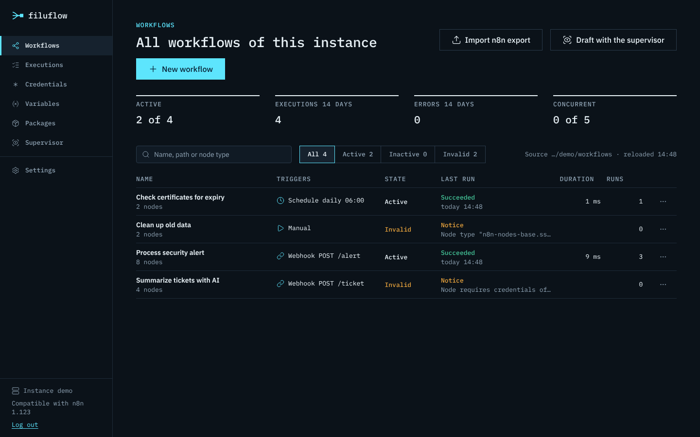
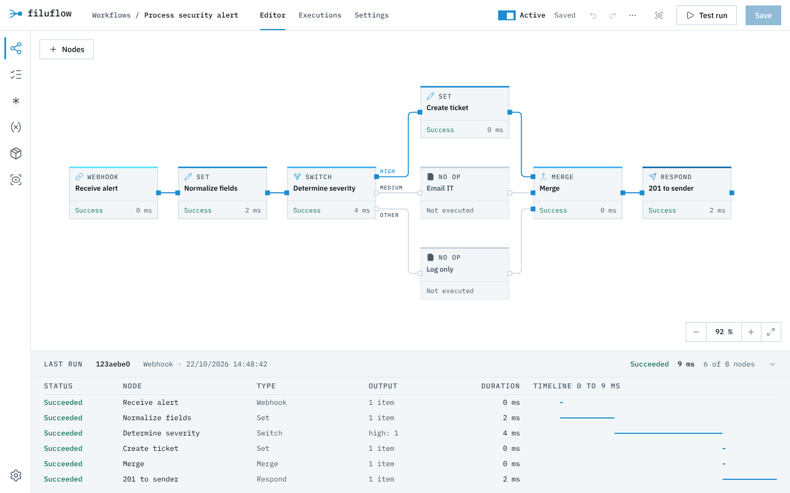

<p align="center">
  <picture>
    <source media="(prefers-color-scheme: dark)" srcset="docs/assets/filuflow-logo-dark.svg">
    
  </picture>
</p>

<p align="center">
  <strong>Build, run and trace workflows. On your own servers, for one team or many tenants.</strong>
</p>

<p align="center">
  <a href="#quick-start">Quick start</a> ·
  <a href="#web-interface">Web interface</a> ·
  <a href="#server-and-api">Server and API</a> ·
  <a href="#multiple-users-and-tenants">Master and Worker</a> ·
  <a href="#configuration">Configuration</a> ·
  <a href="#documentation">Documentation</a>
</p>


filuflow (Latin *filum*, the thread) is a lean workflow engine with a browser editor. A workflow connects nodes
into a flow: a webhook receives a message, nodes transform the data, branch, call services and AI models,
and respond. Every run is logged and can be traced node by node.

## What filuflow can do

| | |
|---|---|
| **Browser editor** | Add and connect nodes, parameters as a form or JSON, undo and redo, test run with the current state |
| **Traceable runs** | Status and duration on every node, the path taken highlighted, "Last run" with timeline, execution log in SQLite |
| **Triggers** | Webhooks with response nodes and authentication, schedules, polling (Gmail Trigger, poll nodes from packages), error workflows, calls from other workflows, REST API |
| **Nodes** | Set, filter, sort, summarize, branch (If, Switch), merge, loops, code (JavaScript and Python), HTTP (with pagination, Digest auth, client certificates), HTML, XML, date, crypto, Gmail (messages, labels, drafts, threads, send and wait for approval) and Gmail Trigger |
| **AI** | AI Agent with tools, LLM Chain, extraction, classification, sentiment analysis; models from OpenAI, Anthropic, Google Gemini, Azure, Mistral, Groq, DeepSeek, OpenRouter and Ollama; embeddings, vector stores and Q&A Chain (RAG) |
| **Supervisor** | a model keeps an eye on the workflows: fixed rules, analysis of failed runs, daily report, improvements as a validated proposal with diff, conversation in the editor, also in the master per worker; a human decides |
| **Credentials** | create and edit in the interface (forms per type) or maintain as a file, encrypted with AES-256-GCM, values from environment variables; secret values never appear in logs or the interface |
| **Team and tenants** | Master with users, permissions and projects; workers in each tenant's environment; login with password and TOTP or SSO (OIDC) |
| **Command line** | Validate and run workflows, view executions, encrypt credentials, manage users |
| **Compatible with n8n** | Exported n8n workflows run without changes, copied n8n nodes can be pasted into the editor |
| **Custom nodes** | Plugins as JavaScript modules or nodes in n8n format (own folders and community packages with `execute`) |
| **Languages** | Interface in English or German (switch under Settings); documentation and messages in English |

## Quick start

Requirement: Node.js 22.

```bash
npm install
npm run build
FILUFLOW_API_KEY=secret npx filuflow serve --dir ./workflows
```

Then open `http://localhost:5678/` and log in with the API key `secret`. Workflows are stored as JSON files in `./workflows`;
new workflows can be created in the editor or dropped in as a file (the server reloads changes automatically).

With Docker:

```bash
FILUFLOW_API_KEY=secret docker compose up -d --build
```

## Web interface

<p>
  
  
</p>

- **Workflows:** metrics (active workflows, executions and errors of the last 14 days, utilization), search and filters
  (All, Active, Inactive, Invalid) and a table with trigger, state, last run, duration and runs.
- **Editor:** add nodes via **Nodes** at the top left (or key N); a click attaches the new node to the selected one.
  Dragging an output onto an input connects them; clicking a connection and pressing Delete removes it. On the right are parameters, credentials,
  settings (disabled, error behavior, retry, notes) and, after the run, the result as a table or JSON.
  You edit parameters in the **Form** with fields per node type (option lists, conditions, assignments, options);
  **Tree** and **JSON** show the same parameters unfiltered.
- **Save** writes the file into the workflow directory, the **Active** toggle switches webhooks and schedules on.
  **Test run** runs the current state, even if unsaved. **Execute up to here** (button at the top of the panel) runs only
  the selected node and the nodes before it. For webhook and form triggers, **Wait for test call** waits for
  the next call of the test URL and runs the state in the editor.
- **Test data:** in the **Result** tab, **Pin** pins a node's output (`pinData`), **Enter test data**
  sets your own data. During a test run the node then returns this data instead of running; a pin appears on the node.
- **Variables:** you maintain values for `$vars` under **Variables**; they take effect immediately in all workflows. Entries from
  `vars.json` stay in the file and take precedence.
- **Last run** below the canvas: status, type, output and duration per node with a timeline; a click selects the node.
- **Executions:** list with filters by workflow and status, detail view with the workflow state of the execution.
- Color scheme dark (default) or light under **Settings**.
- Language: the interface is English by default and can be switched to German under **Settings** (in the master: in the
  profile).

<details>
<summary>Keyboard shortcuts in the editor</summary>

| Key | Effect |
|---|---|
| Ctrl+S | Save |
| Ctrl+Enter | Test run |
| N | Add node |
| Ctrl+Z, Ctrl+Shift+Z | Undo, redo |
| Ctrl+C, Ctrl+X, Ctrl+V | Copy, cut, paste (also nodes from n8n) |
| Ctrl+A | Select all |
| Delete | Delete selection |
| D | Disable or enable node |
| 1 | Fit to view |
| Esc | Clear selection |
| Shift+drag | Rubber-band selection |
| Ctrl+mouse wheel | Zoom |

</details>

## Server and API

```bash
FILUFLOW_API_KEY=secret filuflow serve --dir ./workflows --port 5678 --db ./filuflow.db
```

- Loads all `*.json` from `--dir` and reloads on changes. Active workflows register webhooks (`/webhook/<path>`) and
  schedules; test URLs (`/webhook-test/<path>`) exist for all valid workflows.
- Invalid workflows (for example with unknown nodes) are not activated. The reason is shown in the log, in the overview and
  in `GET /api/workflows`.
- Executions are stored in SQLite, for 14 days by default; at most 5 run at the same time, others wait.
- **Forms:** the Form Trigger provides a form under `/form/<path>` (test: `/form-test/<path>`), with fields
  for text, number, email, date, selection, checkboxes, radio buttons, files, hidden fields and custom HTML. With the
  Form node, further pages and a completion page follow; the Wait node can also wait for a form. The pages
  are normal HTML forms without scripts.
- **Waiting:** the Wait node pauses an execution until a time is reached or a webhook arrives
  (`$execution.resumeUrl`, i.e. `/webhook-waiting/<execution>`, optionally with suffix and authentication). Waiting
  executions are stored in the database and survive a restart; the list shows what they are waiting for, and they can
  be cancelled. Static data (`$getWorkflowStaticData`) and OAuth2 tokens are also kept across restarts.

<details>
<summary>REST API (header <code>X-API-Key</code>)</summary>

| Method and path | Purpose |
|---|---|
| `GET /api/workflows` | all workflows with state, triggers and validity |
| `GET /api/workflows/:id` | one workflow with validation result |
| `POST /api/workflows/:id/run` | run; body = start items, `?wait=false` for asynchronous |
| `GET /api/executions?workflow=&status=&limit=` | executions |
| `GET /api/executions/:id` | one execution with data per node |
| `POST /api/executions/:id/cancel` | cancel a running or waiting execution |
| `ANY /webhook-waiting/:id[/suffix]` | resume a waiting execution (Wait "On Webhook Call") |
| `GET /api/overview` | metrics of the last 14 days, last execution per workflow |
| `GET /healthz` | health check (without API key) |

</details>

<details>
<summary>Example with curl</summary>

```bash
mkdir -p /tmp/fl/workflows && cp fixtures/08-webhook-respond/workflow.json /tmp/fl/workflows/
cd /tmp/fl && FILUFLOW_API_KEY=secret filuflow serve --port 5690 --dir workflows &

curl -i -X POST 'http://localhost:5690/webhook/fl-fixture-08?n=3' -H 'content-type: application/json' -d '{"name":"Ada"}'
# HTTP/1.1 201 Created
# {"gruss":"Hallo Ada","anzahl":6,"tags":null}

curl -s -H 'X-API-Key: secret' 'http://localhost:5690/api/executions?limit=5'
filuflow executions list --db /tmp/fl/filuflow.db
```

</details>

### Command line

```bash
filuflow validate <workflow.json> [--json]
filuflow run <workflow.json> [--input items.json] [--trigger "Node"] [--json] [--only-last] [--no-pin]
filuflow executions list|show <id> [--json] [--db ./filuflow.db]
filuflow credentials encrypt|decrypt|check <credentials.json>
filuflow credentials import <n8n-export.json> [--n8n-key <k>] [--out <file> | --managed <file>]
filuflow nodes [--json]
```

`filuflow run` validates the workflow first (unknown nodes or versions abort before anything runs) and then shows a
summary per node:

```text
$ filuflow run fixtures/01-linear/workflow.json
Workflow "01 Lineare Kette", Execution efdf1bcf-...
  OK     Start        0 ms  1 Item
  OK     Felder      22 ms  1 Item
  OK     Erzeugen     2 ms  5 Items
  OK     Gross?       4 ms  Output 0: 4, Output 1: 1
  OK     Wahr         0 ms  4 Items
  OK     Falsch       2 ms  1 Item
Status: success, Duration 33 ms
```

<details>
<summary>Options of <code>run</code></summary>

- `--input`: start items, as an array of `{ "json": ... }` or plain objects
- `--trigger`: start node, if the workflow has multiple triggers
- `--json`: complete execution including data per node (credential values masked)
- `--only-last`: only the output of the last executed node
- `--no-pin`: ignore pinned test data (`pinData`)
- `--credentials`, `--vars`, `--workflows`: credentials, variables (`$vars`) and directory for sub-workflows

Exit code 0 on success, 1 on errors (validation or failed execution).

</details>

## Credentials

The easiest way is to create credentials in the interface: on the **Credentials** page or directly in the editor via the selection on the node
("Create new credential"). The form knows the fields of the built-in types and shows the matching ones depending on the selection;
for other types you enter the fields freely. Secret fields (passwords, tokens, API keys) are never shown again after
saving: an empty field when editing keeps the stored value. The interface also shows which workflows use a
credential.

**OAuth2 with sign-in at the provider** (grant type "Authorization Code" or "PKCE", e.g. Google, Microsoft 365, Slack):
register the redirect URL `<FILUFLOW_WEBHOOK_URL>rest/oauth2-credential/callback` with the provider (the same as in
n8n, the form shows it), create the credential and click **Connect** in the list. The token is stored
encrypted in the database and is renewed with the refresh token when access has expired. In the master, sign-in
runs via the master's address, and the token is stored on the worker.

Many services have their own OAuth2 types with n8n's data, such as `googleOAuth2Api`, `gmailOAuth2`,
`googleSheetsOAuth2Api`, `googleDriveOAuth2Api`, `microsoftOAuth2Api`, `microsoftOutlookOAuth2Api`, `microsoftTeamsOAuth2Api`,
`slackOAuth2Api`, `githubOAuth2Api`, `notionOAuth2Api`, `hubspotOAuth2Api`, `airtableOAuth2Api`, `salesforceOAuth2Api` and
more (47 in total). There you only enter client ID and client secret (for some services also server, subdomain
or environment); URLs, scopes and grant type are set by the type. Exported n8n workflows with these credentials thus run
without changes.

**Predefined credential types** in HTTP Request ("Predefined Credential Type"): filuflow knows the authentication of
`githubApi`, `notionApi`, `slackApi`, `stripeApi`, `airtableTokenApi`, `hubspotAppToken`, `openAiApi`, `anthropicApi`,
`googlePalmApi` and the generic types, plus types from plugins. OAuth2 types (the built-in ones above, types ending in
`…OAuth2Api` from an n8n import or from plugins) use the connected token, with the services' quirks as in
n8n (e.g. Slack with the user token). The same applies to the HTTP Request Tool on the AI Agent.

**OAuth1** (`oAuth1Api`, e.g. older APIs of Twitter/X, Trello or Xero) works the same way: enter consumer key and secret as well as
the provider's three URLs, save, **Connect**. As the redirect, filuflow uses
`<FILUFLOW_WEBHOOK_URL>rest/oauth1-credential/callback`.

**Import from n8n**: credentials exported with `n8n export:credentials --all --output=export.json` (encrypted or with
`--decrypted`) are imported with the **Import from n8n** button on the Credentials page, in the master on the worker page. For
encrypted exports you provide the n8n key (`N8N_ENCRYPTION_KEY` of the n8n instance). On the command line use
`filuflow credentials import export.json --n8n-key ... --managed credentials.managed.json`. IDs are preserved, so that
imported workflows find their credentials.

**Sharing in the master**: a worker's credentials are initially available to all projects of that worker. Via the
**Sharing** icon on the worker page you restrict a credential to individual projects.

Credentials created in the interface end up in `credentials.managed.json` (file mode 0600, encrypted with `FILUFLOW_ENCRYPTION_KEY`;
path via `FILUFLOW_MANAGED_CREDENTIALS`). Without a key, the interface points this out.

Alternatively or additionally, credentials can be kept in `credentials.json` (or in a directory with one file per credential).
These entries are visible in the interface, but can only be changed in the file, and take precedence. The key is the name
under which a workflow uses the credential:

```json
{
  "API Header": { "id": "abc123", "type": "httpHeaderAuth", "data": { "name": "X-Api-Key", "value": "{{ env.API_KEY }}" } },
  "Token-Server": { "type": "oAuth2Api", "data": { "grantType": "clientCredentials", "accessTokenUrl": "https://auth.example/token",
                    "clientId": "filuflow", "clientSecret": "{{ env.OAUTH_SECRET }}", "scope": "lesen", "authentication": "header" } }
}
```

- Types: `httpHeaderAuth`, `httpBasicAuth`, `httpDigestAuth`, `httpQueryAuth`, `httpBearerAuth`, `httpCustomAuth`, `oAuth2Api`,
  `oAuth1Api`, `jwtAuth`, `httpSslAuth` (client certificate and own CA for "SSL Certificates"),
  for AI models `openAiApi`, `anthropicApi` and `googlePalmApi` (each `apiKey`, optionally a custom URL).
- `{{ env.NAME }}` takes values from the environment; `filuflow validate` reports missing credentials and variables.
- Encrypt: `FILUFLOW_ENCRYPTION_KEY=... filuflow credentials encrypt credentials.json --out credentials.enc.json`.
  Names and types stay readable, `decrypt` for editing, `check` for validation.
- Secret values do not leave the server and appear masked in the log; the related REST API is under `/api/credentials`.

## Code in JavaScript and Python

The Code node supports three languages (**Language** selection in the editor):

- **JavaScript**: all expression variables (`$input`, `$json`, `$('Node')`, `$now` …), `console.log` ends up in the
  execution log. As in n8n, `helpers` offers `httpRequest`, `httpRequestWithAuthentication` (with a
  credential on the node), `returnJsonArray`, `constructExecutionMetaData`, `prepareBinaryData`, `getBinaryDataBuffer` and others.
- **Python**: runs with [Pyodide](https://pyodide.org) (CPython as WebAssembly) directly in the server, without an installed Python.
  As in n8n, the variables use `_` instead of `$`: `_input.all()`, `_json`, `_('Node')`, `_now`, `_jmespath()`.
  Objects can be read as attributes or keys (`item.json.name`, `item.json['name']`), `print()` ends up in the log.
  The standard library is included; Pyodide loads packages such as numpy or pandas from the network on the first `import`
  (`FILUFLOW_PYTHON_PACKAGES_DIR`). The first run after startup takes about two seconds; if a workflow uses Python,
  the server already loads Pyodide at startup.
- **Python (Native)**: uses the server's Python interpreter (`FILUFLOW_PYTHON`, default `python3`) in a separate
  process per execution, with all packages installed there. As in the n8n task runner, there is only `_items` (all items) or
  `_item` (per item) as dicts. Imports are only allowed with an allowance: `FILUFLOW_PYTHON_STDLIB_ALLOW=json,datetime,re` and
  `FILUFLOW_PYTHON_EXTERNAL_ALLOW=numpy` (`*` for all; the n8n names `N8N_RUNNERS_STDLIB_ALLOW` etc. also apply).
  Builtins such as `eval`, `open` or `getattr` are blocked (`FILUFLOW_PYTHON_BUILTINS_DENY`), the environment is empty
  (`FILUFLOW_PYTHON_ENV_ACCESS=true` exposes it).

```python
# Python: iterate over all items
for item in _input.all():
    item.json.summe = item.json.netto * 1.19
return _input.all()
```

All variants have a time limit (`FILUFLOW_CODE_TIMEOUT_MS`, default 60 s) that also ends infinite loops. The Code Tool
for AI agents can use Python too. `FILUFLOW_PYTHON_ENABLED=false` disables Python.

## AI nodes

AI Agent (Tools Agent), Basic LLM Chain, Information Extractor, Text Classifier and Sentiment Analysis, with the models of
OpenAI (Chat Completions and Responses API with web search, file search and code interpreter), Anthropic, Google Gemini, Azure
OpenAI, Mistral, Groq, DeepSeek, OpenRouter and Ollama (local), the tools Calculator, Code, HTTP Request, Workflow and Think,
and a simple conversation memory. Models and tools attach to the agent as separate nodes and appear in the log with their own
runs. The models are called directly via HTTP, without additional libraries.

**Querying knowledge (RAG):** the Simple Vector Store ingests documents (Default Data Loader for JSON, text, Markdown and CSV,
Text Splitter, OpenAI Embeddings) and returns the most similar chunks: directly as a node, via the Vector Store
Retriever to the Question and Answer Chain, or as a tool for the AI Agent (also via the Vector Store Question Answer Tool).
As in n8n, the data is kept in the process's memory and is empty after a restart.

**Chat:** the Chat Trigger starts a workflow with a chat message. In the editor, the chat button in the
header opens a chat window; every message is a test run with the current state. If the chat is public, there is
a chat page of its own under `/webhook/<webhookId>/chat` (title, greeting, placeholder configurable, optional Basic auth) or only
the endpoint for embedding. The response is the first item of the last node (`output` or `text`) or comes from a
Respond to Webhook node.

**Streaming:** with the response mode "Streaming" (Webhook from v2.1, Chat Trigger from v1.2), the AI Agent writes its
response word by word into the running HTTP response, and the chat page shows it immediately. As in n8n, the response consists of
JSON lines (`{"type":"begin|item|end|error","content":…,"metadata":{…}}`); Respond to Webhook from v1.5 writes into it
as well.

**Follow-up questions in chat:** with the response mode "Using Response Nodes", "Respond to Chat" nodes send messages to the
chat page and wait for the person's reply, for example for clarifying questions or approvals (human in the loop). For this the page keeps
a channel open to the running execution; the execution waits persistently and also survives a restart.

## Supervisor

The Supervisor keeps an eye on the workflows and reports what it notices. It never changes anything itself.

- **Fixed rules** check all workflows at startup and every 15 minutes: invalid workflows, failed activations,
  frequent errors and high error rates, cancelled executions, considerably longer runtimes, active workflows without
  error handling, passwords or tokens in plain text, disabled nodes, nodes without input, older node versions
  and HTTP requests without retry. Fixed issues disappear by themselves, dismissed ones stay dismissed.
- **Failed executions** are collected and counted per error pattern. With a model, the Supervisor explains
  cause and solution, automatically once per error pattern or on demand.
- **Daily report** at the configured hour with numbers and, with a model, a short summary.
- **Proposals:** for a finding, the Supervisor creates a proposal on demand. It is validated before display and
  shown as a list of changes (nodes, parameters, connections, settings). You accept it (the workflow is
  saved, the activation stays), dismiss it or start a test run first. If the workflow has changed since the
  proposal, the proposal is outdated and can no longer be accepted.
- **Ask in the editor:** the "Ask Supervisor" button opens a conversation about the open workflow ("Why did the last
  run fail?", "Retry the HTTP Request three times on errors."). Requested changes arrive as a proposal
  in the panel. With "Draft with the Supervisor" on the Workflows page you describe a new workflow; the Supervisor
  builds it, validates it and creates it inactive after your approval.

Under "Supervisor, Settings" you choose provider, credential and model ID (Anthropic, OpenAI, Google Gemini, Ollama,
Mistral, Groq, DeepSeek, OpenRouter, Azure OpenAI; the same credentials as for the AI nodes), the data scope ("Structure
and errors" or "With sample data"), a daily budget in tokens and workflows that the Supervisor does not look at.
Credential values and parameters such as passwords or API keys are always masked before anything goes to the model
(details in `docs/SECURITY.md`). Without a model, the Supervisor works with the fixed rules only. REST API under
`/api/supervisor`, disable with `FILUFLOW_SUPERVISOR=false`.

## Custom nodes (plugins)

At startup filuflow loads custom nodes from `~/.filuflow/custom`, from the paths in `FILUFLOW_CUSTOM_EXTENSIONS` (separated
by `;`; `N8N_CUSTOM_EXTENSIONS` also works) and from `--nodes <path>` (for `validate`, `run`, `serve`, `worker`, `master` and
`nodes`). Loading problems appear as a notice, the rest keeps running; `filuflow nodes` shows what is loaded.

**Nodes in n8n format:** a folder with `*.node.js` and `*.credentials.js` (like `~/.n8n/custom`, type `CUSTOM.<name>`) or a
community package (folder with `package.json` and `"n8n": { "nodes": [...], "credentials": [...] }`, type `<package>.<name>`, also in
the folder's `node_modules`). Supported are programmatic nodes with `execute()`, including versioned ones; the context offers the
usual functions (`getInputData`, `getNodeParameter` with defaults, `getCredentials`, `continueOnFail`,
`helpers.httpRequest` and `request` with and without authentication, `returnJsonArray`, `constructExecutionMetaData`,
binary data). The package `n8n-workflow` does not need to be installed: filuflow provides error classes, connection types and
helper functions. Declarative nodes (without `execute`, requests described via `requestDefaults` and `routing`, like
many community nodes from the n8n template) run as well, with pagination, post-processing and the "Request
Options" setting (batching, proxy, timeout). Poll nodes (e.g. mailbox or feed triggers) poll in the active workflow according to the
"Poll Times" (as in n8n at most every minute, first poll on activation) and remember their state in the static
data; trigger nodes with their own connection (e.g. message brokers) start executions via `emit` and are closed on
deactivation. In the editor both run once directly. Webhook nodes from packages get their URL as in n8n
(`/webhook/<webhookId>/<path>`, test under `/webhook-test/…`); nodes that register with the service (`webhookMethods`)
register on activation and unregister on deactivation, in the editor also for the test URL. AI sub-nodes from packages are
not loaded yet.

**Installing community packages:** on the **Packages** page (in the master on a worker's page) you install
n8n community packages from npm by name (`n8n-nodes-…` or `@scope/n8n-nodes-…`, optionally with a version), update and
remove them. As in n8n, filuflow downloads the package with `npm pack`, installs its dependencies without
install scripts and makes the nodes available immediately, without a restart; workflows are revalidated afterwards. The packages
are stored in `~/.filuflow/nodes` (`FILUFLOW_NODES_DIR`) and are loaded at startup as well as by `validate` and `run`. The same
functions are offered by the REST API under `/api/community-packages` (GET, POST and PATCH with `{ "name", "version" }`, DELETE with
`?name=`). `FILUFLOW_COMMUNITY_PACKAGES_ENABLED=false` disables installing, a custom registry is set with
`FILUFLOW_COMMUNITY_PACKAGES_REGISTRY` (each also with `N8N_` instead of `FILUFLOW_`).

**filuflow plugins:** an ES module (`*.mjs` or a package with `"filuflow": { "plugin": "index.js" }`) that exports an object or a
function:

```js
export default (api) => ({
  nodes: [{
    type: 'acme.greeting', displayName: 'Greeting', versions: [1],
    parameters: [{ name: 'name', label: 'Name', type: 'string', default: '' }],
    async execute(ctx) {
      return [ctx.items.map((item, i) => ({ json: { ...item.json, greeting: `Hello ${ctx.getParam('name', i, '')}` } }))];
    },
  }],
  credentialTypes: [{ name: 'acmeApi', label: 'Acme', description: '', fields: [{ name: 'token', label: 'Token', kind: 'password' }] }],
});
```

Plugin nodes appear in the editor under "Extensions", with a form from their parameter description. In master mode the
plugins belong on the workers (execution) and on the master (editor and validation).

## Multiple users and tenants

For teams and for operation at multiple customers there are two further operating modes. Single-server operation with `filuflow serve`
remains unaffected.

```text
          Team (browser)
               │  Login: password + TOTP or SSO (OIDC)
        ┌──────▼───────┐
        │   Master     │  users, permissions, projects, workflows (versioned), audit log
        └──┬────────┬──┘
   HTTPS + │        │ HTTPS + worker token
   token   │        │
   ┌───────▼──┐  ┌──▼───────┐
   │ Worker   │  │ Worker   │  in the tenant's environment: executes, webhooks, schedules;
   │ cust. A  │  │ cust. B  │  credentials and execution data stay here
   └──────────┘  └──────────┘
```

- **Master** (`filuflow master`): interface with login, projects, editor and administration. Executes nothing itself.
- **Worker** (`filuflow worker`): a server with an API for the master. The master connects to the worker (not the other way round) and
  distributes workflows on save. If the master fails, the workers keep running.
- **Tenant:** a group of workers, for example test and production of one customer. **Project:** a folder for workflows with
  members, assigned to exactly one worker.
- **Roles:** globally administrator or member. In the project: Read, Edit (change, run, activate, delete) or
  Project admin (additionally members). Under **Administration, Roles** administrators create custom roles with precisely
  chosen permissions (e.g. "Operations": run and activate, but not edit); they are available for selection in the project and for
  individual workflows.
- **Roles per workflow:** via **Roles** (menu in the workflow list or in the editor) a person gets a different role for a single
  workflow than in the project: Edit for otherwise read-only members, "No access" for a confidential workflow or
  "Manage" (may assign roles themselves). People outside the project then see the project as a guest with exactly the workflows
  shared with them. Project admins and global administrators always have full access.
- **Supervisor:** each worker has its own Supervisor. The **Supervisor** page in the master shows findings and proposals
  of all workers for the workflows you may see. Analyzing, creating proposals and the Supervisor panel in the editor
  need the permission "Use Supervisor" (included in "Edit"), accepting additionally "Edit". An accepted
  proposal becomes a new version in the master and is distributed like any version; it cannot be accepted on the worker itself.
  Administrators configure model, budget and reports per worker (Administration, Workers, Supervisor).
- **Executions** in the sidebar searches the executions of all projects across all workers at once: by text (ID,
  workflow, node, error message), status, project, worker and time range. Unreachable workers appear as a notice.
- Workflows are versioned in the master. If two people save at the same time, the editor asks; older versions can
  be restored.
- Language: the interface is English by default; each person can switch it to German in the profile.

### Starting a worker (at the tenant)

```bash
FILUFLOW_API_KEY=<long-random-value> FILUFLOW_ENCRYPTION_KEY=<key> \
FILUFLOW_WEBHOOK_URL=https://flows.customer.example/ filuflow worker --dir ./workflows --port 5678
```

- `FILUFLOW_API_KEY` (at least 16 characters) is the token that the master enters for the worker.
- Workflows from the master end up as `<id>.json` in `--dir`; workflows placed there by hand stay untouched.
- Credentials: the hand-maintained `credentials.json` (read-only, takes precedence) plus `credentials.managed.json`, which
  administrators maintain in the master with the same form; the master can never read secret values back.
- The worker's own interface is off (`FILUFLOW_UI=true` turns it on).

### Starting the master

```bash
FILUFLOW_ENCRYPTION_KEY=<key> FILUFLOW_PUBLIC_URL=https://filuflow.example filuflow master --port 5679 --db ./master.db
```

On first start the master writes a setup token to the log; with it you create the first administrator under `/#/setup`.
Then, under **Administration**, create a tenant, enter the worker with address and token, create a project, assign it to the
worker and add members.

<details>
<summary>Master environment variables</summary>

| Variable | Meaning |
|---|---|
| `FILUFLOW_ENCRYPTION_KEY` | Required, at least 16 characters. Encrypts worker tokens and TOTP secrets. Keep it safe: without it, workers and TOTP must be set up again |
| `FILUFLOW_PUBLIC_URL` | Address of the master (with `https://`, cookies with Secure) and target of the SSO redirect |
| `FILUFLOW_MASTER_DB` / `--db` | SQLite file (default `./master.db`) |
| `FILUFLOW_PORT` / `--port` | Port (default 5679) |
| `FILUFLOW_ADMIN_EMAIL`, `FILUFLOW_ADMIN_PASSWORD` | first admin on first start instead of a setup token |
| `FILUFLOW_SESSION_HOURS` | session ends after this many hours of inactivity (default 12, at the latest after 7 days) |
| `FILUFLOW_SYNC_SECONDS` | sync with the workers (default 60, 0 = off) |
| `FILUFLOW_TRUST_PROXY` | `true` behind a reverse proxy (IP from `X-Forwarded-For` for limiting login attempts) |

</details>

<details>
<summary>Login via SSO (OpenID Connect)</summary>

The master can additionally sign users in via an identity provider (Keycloak, Entra ID, Google, Authentik, Zitadel and others;
authorization code flow with PKCE). Create a client at the identity provider with the redirect URL
`<FILUFLOW_PUBLIC_URL>/api/auth/oidc/callback`, then:

| Variable | Meaning |
|---|---|
| `FILUFLOW_OIDC_ISSUER` | Issuer URL (discovery under `/.well-known/openid-configuration`) |
| `FILUFLOW_OIDC_CLIENT_ID`, `FILUFLOW_OIDC_CLIENT_SECRET` | Client; without a secret as a public client with PKCE |
| `FILUFLOW_OIDC_LABEL` | Text of the login button (default "Sign in with SSO") |
| `FILUFLOW_OIDC_SCOPES` | Default `openid email profile` (add `groups` for groups if needed) |
| `FILUFLOW_OIDC_AUTO_CREATE=true` | create unknown users as members on first login |
| `FILUFLOW_OIDC_ALLOWED_DOMAINS` | only these email domains, comma-separated |
| `FILUFLOW_OIDC_ADMIN_GROUP`, `FILUFLOW_OIDC_GROUPS_CLAIM` | members of this group become admin, everyone else member; the last admin stays admin |

Mapping first via the identity at the identity provider, otherwise via the email address of an existing user. With SSO,
filuflow does not ask for TOTP; the second factor is handled by the identity provider.

</details>

<details>
<summary>Users on the command line (emergency access)</summary>

```bash
FILUFLOW_NEW_PASSWORD=... filuflow master user add --email ada@example.org --name "Ada" --admin --db ./master.db
filuflow master user list --db ./master.db
filuflow master user set-password --email ada@example.org --db ./master.db     # prompts for the password
filuflow master user reset-totp --email ada@example.org --db ./master.db
```

</details>

In the profile, each person manages password, two-factor login, interface language and API tokens for scripts (`Authorization: Bearer ffl_…`).
Under **Administration**, administrators see all tenants and workers (reachable, version, undistributed workflows, errors),
set credentials on the worker, manage users and read the audit log. Under **Shared credentials** they maintain
a credential once in the master and distribute it to multiple workers: the master stores it encrypted, creates it on the
selected workers (with the same ID, so that workflow references match), replaces it there on changes, renames it along,
removes it when the assignment is lifted and catches up on failures at the next sync.

## Configuration

| Variable | Meaning | Default |
|---|---|---|
| `FILUFLOW_API_KEY` | key for REST API and interface; without it the API is locked | |
| `FILUFLOW_DIR` / `--dir` | workflow directory | `./workflows` |
| `FILUFLOW_DB` / `--db` | SQLite file for executions | `./filuflow.db` |
| `FILUFLOW_PORT`, `FILUFLOW_HOST` | server address | `5678`, `0.0.0.0` |
| `FILUFLOW_WEBHOOK_URL` | public base URL for webhooks | `http://localhost:5678/` |
| `FILUFLOW_CREDENTIALS`, `FILUFLOW_VARS` | credentials and variables | `./credentials.json`, `./vars.json` |
| `FILUFLOW_ENCRYPTION_KEY` | key for encrypted credentials | |
| `FILUFLOW_MANAGED_CREDENTIALS` | file for credentials from the interface or from the master | `./credentials.managed.json` |
| `FILUFLOW_CONCURRENCY` | simultaneous executions | `5` |
| `FILUFLOW_PRUNE_DAYS` | retention of executions in days | `14` |
| `FILUFLOW_TIMEZONE` | time zone for schedules and date values | `Europe/Berlin` |
| `FILUFLOW_CODE_TIMEOUT_MS` | time limit for Code nodes | `60000` |
| `FILUFLOW_PYTHON`, `FILUFLOW_PYTHON_STDLIB_ALLOW`, `FILUFLOW_PYTHON_EXTERNAL_ALLOW` | Python (Native): interpreter and allowed imports | `python3`, none, none |
| `FILUFLOW_PYTHON_PACKAGES_DIR` | storage for downloaded Python packages (Pyodide) | `~/.cache/filuflow/pyodide` |
| `NODE_FUNCTION_ALLOW_BUILTIN`, `NODE_FUNCTION_ALLOW_EXTERNAL` | modules for `require` in the Code node (names separated by commas, or `*`); also as `FILUFLOW_FUNCTION_ALLOW_*` | none |
| `FILUFLOW_RESTRICT_FILE_ACCESS_TO` | directories from which Execute Workflow may read files (separated by `;`) | all |
| `FILUFLOW_ENV_ALLOW` | which environment variables `$env` returns | prefix `FL_` |
| `FILUFLOW_PAYLOAD_SIZE_MAX` | maximum request size in MB | `16` |
| `FILUFLOW_UI` | `false` disables the interface | on |
| `FILUFLOW_INSTANCE_NAME` | name in the sidebar footer | hostname |
| `FILUFLOW_IMPRINT_URL`, `FILUFLOW_PRIVACY_URL` | "Imprint" and "Privacy" links (only if set) | |
| `FILUFLOW_LOG_LEVEL` | log level (pino) | `info` |
| `FILUFLOW_CUSTOM_EXTENSIONS` / `--nodes` | paths to custom nodes (separated by `;`; also `N8N_CUSTOM_EXTENSIONS`) | `~/.filuflow/custom` |
| `FILUFLOW_NODES_DIR` | folder of community packages installed via the interface | `~/.filuflow/nodes` |
| `FILUFLOW_COMMUNITY_PACKAGES_ENABLED`, `FILUFLOW_COMMUNITY_PACKAGES_REGISTRY` | allow installing community packages, npm registry (also `N8N_…`) | `true`, `https://registry.npmjs.org` |
| `FILUFLOW_SUPERVISOR` | Supervisor (rules, analyses, proposals) on or off | `true` |

### Docker

`docker-compose.yml` starts a single server, `docker-compose.master.yml` and `docker-compose.worker.yml` show master and
worker. The image is based on `node:22-slim` and runs as user `node` with the working directory `/data` (workflows under
`/data/workflows`, optionally `/data/credentials.json` and `/data/vars.json`).

A prebuilt image is available in the GitHub Container Registry (`ghcr.io/mebytede/filuflow:main`, see Development); to
build it yourself:

```bash
docker build -t filuflow .                                   # with Python (Native): --build-arg WITH_PYTHON=true
docker run -p 5678:5678 -e FILUFLOW_API_KEY=secret -v "$PWD/data:/data" filuflow
```

For operation on a network, put a reverse proxy with HTTPS in front. Workers should be reachable via HTTPS or a VPN.

## Working with n8n

filuflow reads the n8n workflow format. Exported workflows (JSON, `executionOrder: v1`) run without changes and deliver
the same data at the same nodes as n8n 1.x; comparison tests against real n8n verify this (reference 1.123.0). Credentials from
`n8n export:credentials` can be used directly (encrypted ones with `N8N_ENCRYPTION_KEY`), copied n8n nodes can be pasted into the editor.

## Development

```bash
npm test             # unit tests, comparison tables and browser tests of the interface (Chromium)
npm run test:compat  # comparison with recorded results from n8n (CLI, engine, webhooks)
npm run lint         # eslint and TypeScript
npm run build        # CLI, server and interface to dist/
```

TypeScript (strict, ESM) on Node.js 22, fastify, SQLite (better-sqlite3), luxon and croner. The interface works without a framework
and is built with `tsc`.

The CI on GitHub (`.github/workflows/ci.yml`) checks every pull request and every push to `main`: lint, tests with Chromium,
golden tests, build and the Docker image (build, start, `/healthz`). After a push to `main` the image is available at
`ghcr.io/mebytede/filuflow:main` and `ghcr.io/mebytede/filuflow:<commit>`.

## Documentation

- [docs/STATUS.md](docs/STATUS.md): development status
- [docs/SECURITY.md](docs/SECURITY.md): security model, login, credentials
- [docs/DECISIONS.md](docs/DECISIONS.md): decisions and dependencies
- [docs/SPEC.md](docs/SPEC.md): specification and planned work

> **Formerly flowlite.** filuflow was called flowlite until October 2026. Old environment variables (`FLOWLITE_*`) still apply as long as the
> new one is not set; a notice appears at startup. The default database is now called `filuflow.db` (rename an existing
> `flowlite.db` or pass it with `--db`). API tokens with `flt_` remain valid.
